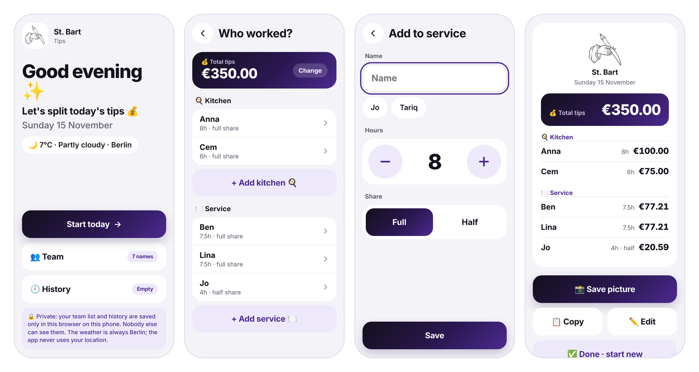
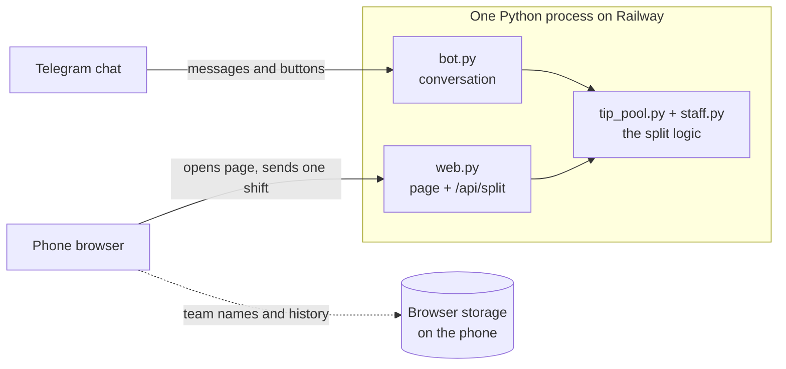

<p align="center">
  
</p>

<h1 align="center">St. Bart Tips</h1>

<p align="center">
  A tip splitter for restaurant staff, built for the team I work with in Berlin.<br>
  It runs as a Telegram bot and as a phone-friendly web app, from one small Python service.
</p>

<p align="center">
  <a href="https://tipsstafftelegram-production.up.railway.app/"><b>Open the app</b></a>
  &nbsp;·&nbsp;
  <a href="#how-to-use-it">How to use it</a>
  &nbsp;·&nbsp;
  <a href="#how-it-works">How it works</a>
  &nbsp;·&nbsp;
  <a href="#run-it-yourself">Run it yourself</a>
</p>

<p align="center">
  
</p>

## Why it exists

At the end of a shift someone has to split the tip pot between kitchen and service, by hours worked. I wrote a Telegram bot to do the maths, colleagues kept using it, so I added a web app that anyone can open from a link.

## What it does

| | |
|---|---|
| 💰 **Splits the pot** | Half to the kitchen, half to service, then by hours within each team. A half share counts half the hours. |
| ✏️ **Fixes mistakes** | Change the total, a name, the hours or the share at any point, before or after the result. |
| 👥 **Remembers the team** | Save names once, then tap them instead of typing. Typing narrows the suggestions. |
| 🕘 **Keeps a history** | Every calculated split is saved, and can be reopened or deleted. |
| 📸 **Shares the result** | Save the result as a picture or copy it as text. |
| 🔒 **Stays private** | Team names and history are kept in the browser on each person's phone. The server stores nothing. |
| 🌤️ **Small touches** | A greeting that changes, the date, and the current weather in Berlin. |

## How to use it

### The app

1. Open **[the link](https://tipsstafftelegram-production.up.railway.app/)** on your phone.
2. Optional: tap **Share → Add to Home Screen** so it opens like a normal app.
3. Tap **Start today** and enter the total tips.
4. Add who worked in the **kitchen** and in **service**, with their hours. Use the big − and + buttons, and pick **Full** or **Half** share.
5. Tap **Calculate**.
6. **Save picture** or **Copy** the result, then **Done** to start fresh next time.

To save names in advance, open **Team** on the home screen. Past days are under **History**.

### The Telegram bot

1. Send `/start` and tap **💰 New Tip Split**.
2. Follow the questions: total, which team first, then each person's name, hours and share.
3. Tap **✅ Done** for each team to get the result.
4. Tap **✏️ Edit** at any time to change the total or a person.

## How it works



The split logic lives in two small files with no Telegram or web code in them, so the bot and the app always give the same answer.

**The calculation, with €350 as an example**

1. Cut the pot in half: €175 for the kitchen, €175 for service.
2. For each team, add up the hours and divide the team's half by that number. That gives a rate per hour.
3. Each person gets their hours times that rate. Someone on a half share has their hours counted at half.

So with Anna (8h) and Cem (6h) in the kitchen, the rate is €175 ÷ 14h = €12.50, and they get €100 and €75.

## Built with

- **Python 3.13**, with [python-telegram-bot](https://python-telegram-bot.org/) for the bot
- **Python's standard library** for the web server, with no web framework
- **Plain HTML, CSS and JavaScript** in a single file, with no build step and no front-end framework
- **[Open-Meteo](https://open-meteo.com/)** for the weather, which needs no API key
- **[Railway](https://railway.com/)** for hosting, deployed from this repository
- **pytest** for the tests

## Project layout

| File | What it is |
|---|---|
| `tip_pool.py`, `staff.py` | The split logic |
| `bot.py` | The Telegram bot: questions, buttons and the Edit flow |
| `web.py` | The web server: serves the page and answers `/api/split` |
| `app.html` | The whole web app in one file |
| `test_bot_flow.py` | Simulated Telegram chats run against the real bot code |
| `test_web.py` | Tests for the web server |
| `main.py` | The original command-line version |

## Run it yourself

```bash
git clone https://github.com/bashar-m-ai/Tips_Staff_Telegram.git
cd Tips_Staff_Telegram
pip install -r requirements.txt
```

**Only the web app** (no Telegram account needed):

```bash
python web.py
# then open http://localhost:8080
```

**The bot and the web app together:** create a bot with [@BotFather](https://t.me/BotFather), put its token in a file named `.env`, and start it.

```bash
echo "TELEGRAM_BOT_TOKEN=your-token-here" > .env
python bot.py
```

**The tests:**

```bash
pip install pytest
python -m pytest -q
```

The tests need no internet and no bot token. They cover the full bot conversation, the Edit flow, wrong input, and the web server.

## Privacy

- Team names and history are saved in the browser on the phone that entered them. They are not shared between colleagues.
- When you tap Calculate, that one shift is sent to the server, the result is sent back, and nothing is kept.
- The weather is always requested for Berlin. The app never asks for the phone's location.

## About

Made by **Bashar Makhlouf**, Applied AI student at IU International University in Berlin, for the colleagues I work with on weekends.

I built it with Claude as a pair programmer, and the commit history shows who wrote what. Deciding what the team needed, trying it out and keeping it running are mine.
